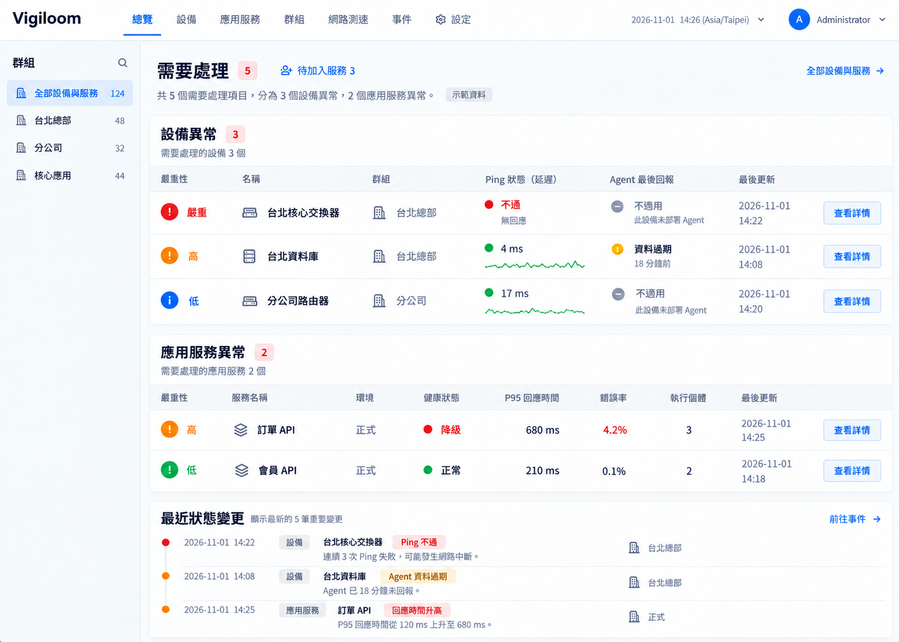

# Vigiloom

**你的設備、伺服器與應用服務，都在同一個地方掌握。**

[](https://github.com/ChengYen-Tang/Vigiloom/actions/workflows/ci.yml)

當網路變慢、伺服器出問題，或應用服務發生異常時，Vigiloom 希望讓你不必在多個工具之間切換：打開網頁，就能查看狀態、追蹤變化，並將適合公開的資訊分享給使用者。

Vigiloom 是一個開源的集中監控平台，目前仍在開發中。



*介面設計示意，畫面中的資料與功能並非目前產品的實際狀態。*

## 一個介面，掌握更多狀況

Vigiloom 正在打造以下功能：

- **網路設備**：查看設備是否可達、Ping 延遲與歷史變化。只需要確認連線狀態的設備，無須安裝 Agent。
- **Windows 與 Linux 伺服器**：透過 Agent 蒐集主機資訊，在中央介面管理 Agent 的版本與更新。
- **應用服務**：整合 OpenTelemetry 與 Health Checks，追蹤服務健康狀態及歷史。服務可獨立監控，不必綁定特定主機。
- **群組與總覽**：依地點、系統或團隊整理設備和服務，快速找到需要關注的項目。
- **公開狀態頁**：選擇要分享的設備和服務，讓訪客查看簡易狀態；內部及進階資訊留給登入使用者。
- **異常通知與網路測速**：從介面設定通知，包括 LINE，並透過測速掌握網路連線情況。
- **與其他工具整合**：透過 Web API，讓既有系統也能取得和管理監控資料。

## 目前的開發狀態

目前已提供帳號登入、設備資料管理及設備 Web API。上述監控、Agent、服務觀測、通知和公開狀態頁等功能尚未完成，暫不適合當作完整監控產品部署。你可以在[需求看板](https://github.com/users/ChengYen-Tang/projects/5)追蹤進度。

## 建置專案

安裝 [global.json](global.json) 指定的 .NET SDK 後，在專案目錄執行：

```sh
dotnet build Vigiloom.slnx --configuration Release
```

要在本機啟動平台及執行測試，請參考[開發環境快速開始](docs/getting-started.md)。
