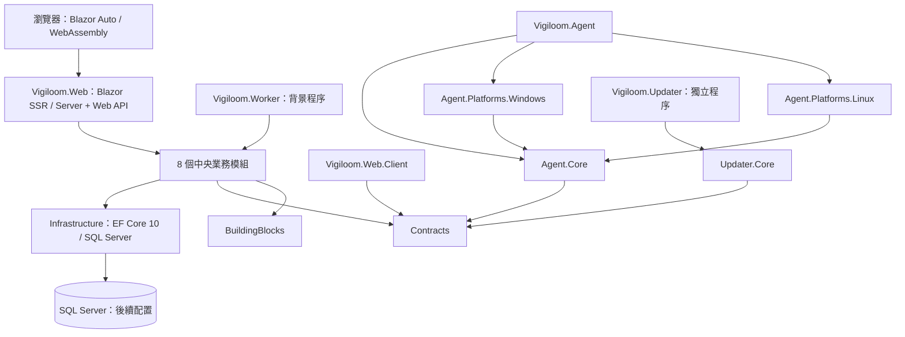

# ADR-0002：模組化中央平台、程序邊界與 Blazor Auto

- 狀態：採用作為重寫骨架（2026-11-01）。
- 來源：使用者要求移除舊方案，建立新 Solution、專案／測試專案與關聯，測試統一 MSTest；另要求前後混合渲染，避免所有 UI 互動壓在 Server。
- 本決策不代表所有產品需求已實作，也不宣告 500 台的容量、SQL 版本／edition 或 OS 支援已驗證。

## 架構與取捨

先採模組化中央平台，Web／API 與 Worker 為可分開執行、同版發布的程序。Agent 與 Updater 是端點獨立程序；每個業務模組是 class library，不是獨立微服務。不引入訊息中介、服務發現、Kubernetes 或多資料庫。

30～500 台 Agent 本身不是拆成微服務的充分理由。先量測接收 EPS／bytes、Trace 抽樣、補送尖峰、佇列延遲、SQL IO／鎖競爭、查詢 p95 與 UI 同時使用人數；若瓶頸可定位且需要獨立擴充／故障隔離，再提出抽出 intake／工作程序的決策。加 Worker 不會自動解決 SQL／磁碟瓶頸。既有 OPS-01／TSK-OPS-02 定義容量驗證。

上圖是邊界／相依示意。Agent 上傳、更新控制、業務 API、Collector／OTLP 與 SQL 連線都尚未實作；它不是已部署拓樸或通訊契約。Collector 後續按服務觀測需求選配，不與 Vigiloom 主機 Agent 混為一談。

## 模組與資料擁有權

| 模組 | 責任 |
|---|---|
| IdentityAccess | 帳號、角色、人員／機器／API 身分與授權。內建登入在後續需求實作，不直接使用範本的字串 Id／SQLite 模型。 |
| Resources | 設備、設備類型、群組與選配部署關聯。應用服務有獨立身分；群組不自動授權或公開。 |
| NetworkMonitoring | 所有設備的 Ping、可達性、測速、歷史彙總。Ping 不等於應用服務健康。 |
| AgentManagement | 端點註冊、心跳、能力、版本／設定指派、正式套件庫與部署更新狀態。 |
| ServiceObservability | 獨立邏輯服務／instance、三分鐘候選、核准後的 Logs／Metrics／Traces、Health Checks 與歷史健康。服務不強制綁主機。 |
| SecurityAnalysis | 軟體／修補盤點、FIM、規則、漏洞、基準與證據事件。AI Agent／LLM 分析維持擱置。 |
| Publishing | Public 設定、範本、匿名欄位白名單與公開查詢投影。匿名不能取得 IP、Private 資源或進階主機資訊。 |
| AlertingOperations | 告警生命週期、通知、可靠工作、保留清理與診斷。LINE 設定由登入後 Administrator 從 Page 管理。 |

每個模組目前只建立一個 class library 與對應 MSTest 專案，隨需求在專案內建立有用途的資料夾。避免每個模組先拆四層空專案。

- 模組可以參考 BuildingBlocks、Contracts、Infrastructure；不能直接參考另一個模組實作或 Host。
- 跨模組協作使用明確應用契約；目前 Contracts 不含虛構 DTO 或事件。需要更細的公開契約邊界時，先更新設計及架構測試。
- 模組各自擁有 DbContext／schema／migration；不建立一個包辦所有表的共用 DbContext，也不跨模組直接修改表。跨模組交易、Outbox 與 FK 由後續 ERD／契約設計定義。
- Infrastructure 僅先提供 SQL Server 的通用 DbContextFactory 註冊。未建立 entity、產品 DbContext、migration 或資料庫，沒有啟動自動 migrate。
- 設備／主機與應用服務獨立建模，服務不強制綁主機。所有識別碼／時間／重送政策遵循 ADR-0001。
- BuildingBlocks 不放產品 entity 或資料存取；Contracts 保持可在瀏覽器與端點使用，不相依 EF／ASP.NET／OS 適配程式。

## Blazor Web App：Auto，按頁面啟用

Vigiloom.Web 是 ASP.NET Core 主機，提供 SSR、Interactive Server、WebAssembly 靜態資產與未來 API。Vigiloom.Web.Client 容納可在伺服器及瀏覽器執行的互動元件，只參考 Contracts。

- `App.razor` 的 Routes／HeadOutlet 不設定全站互動；公開狀態、簡單表單可用 SSR。需互動頁面在 Client 專案按需求使用 `@rendermode InteractiveAuto`。
- Auto 首次造訪可以用 Server 互動，同時快取 WebAssembly；後續造訪在資產可用時可使用 WebAssembly。已啟動的 Server 元件不會在下載完成後自動原地切換。
- Auto 仍有首次 SignalR circuit、SSR 及 API／資料庫負載；不是保證所有 UI 工作都離開伺服器。若將來要求首次互動也在瀏覽器，改評估 WebAssembly＋prerender。
- 瀏覽器路徑透過授權 API 取得 DTO。互動元件使用的應用 client／facade 在 Server 與 Client 都必須有可用註冊；必要的 Server 端 adapter 呼叫同一應用服務並保留授權檢查，不在 Server 盲目 HTTP 呼叫自己或自動轉發所有 Cookie。
- 不在 Client 放 DbContext、密鑰、內部 entity、OS API 或假定 HttpContext 可用。登入／授權另依內建帳密與 Guid key 需求實作，本輪未產生 SQLite／預設字串 Id 的 Identity 範本。
- 需驗證 SSR、首次 Server、快取後 WebAssembly、prerender 重複載入及兩端授權。現有測試僅驗證主機與 prerender，尚未執行真實瀏覽器的首次／快取後互動驗證。
- UI 風格與逐需求 Product Design 流程不變；目前首頁只有啟動標題，沒有實作產品導覽或功能畫面。

## 背景程序與 Agent／Updater

Worker、Agent 與 Updater 採 Generic Host，可整合 Windows Service／systemd；建立 service 的安裝權限與 OS 版本依後續矩陣驗證。本輪只測一般程序可開始／停止，沒有安裝服務、執行採集或更新。

Agent.Core 保留跨平台採集／傳輸邊界，Windows／Linux 適配只依賴 Core。Updater.Core 不依賴 Agent.Core，Updater 與 Agent 不參考彼此的 Host；本機控制 IPC／安裝生命週期仍由更新需求定義。分成兩個程序不代表已完成可靠更新，不能把 Updater 設成會隨 Agent 停止的子程序群組。

## 相依清單

以下為目前實際 ProjectReference；編譯相依不代表功能已連線：

| 專案 | 直接相依 | 對應測試 |
|---|---|---|
| Vigiloom.BuildingBlocks | 無 | Vigiloom.BuildingBlocks.Tests |
| Vigiloom.Contracts | 無 | Vigiloom.Contracts.Tests |
| Vigiloom.Infrastructure | Vigiloom.BuildingBlocks | Vigiloom.Infrastructure.Tests |
| Vigiloom.Modules.IdentityAccess | Vigiloom.BuildingBlocks、Vigiloom.Contracts、Vigiloom.Infrastructure | Vigiloom.Modules.IdentityAccess.Tests |
| Vigiloom.Modules.Resources | Vigiloom.BuildingBlocks、Vigiloom.Contracts、Vigiloom.Infrastructure | Vigiloom.Modules.Resources.Tests |
| Vigiloom.Modules.NetworkMonitoring | Vigiloom.BuildingBlocks、Vigiloom.Contracts、Vigiloom.Infrastructure | Vigiloom.Modules.NetworkMonitoring.Tests |
| Vigiloom.Modules.AgentManagement | Vigiloom.BuildingBlocks、Vigiloom.Contracts、Vigiloom.Infrastructure | Vigiloom.Modules.AgentManagement.Tests |
| Vigiloom.Modules.ServiceObservability | Vigiloom.BuildingBlocks、Vigiloom.Contracts、Vigiloom.Infrastructure | Vigiloom.Modules.ServiceObservability.Tests |
| Vigiloom.Modules.SecurityAnalysis | Vigiloom.BuildingBlocks、Vigiloom.Contracts、Vigiloom.Infrastructure | Vigiloom.Modules.SecurityAnalysis.Tests |
| Vigiloom.Modules.Publishing | Vigiloom.BuildingBlocks、Vigiloom.Contracts、Vigiloom.Infrastructure | Vigiloom.Modules.Publishing.Tests |
| Vigiloom.Modules.AlertingOperations | Vigiloom.BuildingBlocks、Vigiloom.Contracts、Vigiloom.Infrastructure | Vigiloom.Modules.AlertingOperations.Tests |
| Vigiloom.Web.Client | Vigiloom.Contracts | Vigiloom.Web.Tests（由 Web 主機測試參考） |
| Vigiloom.Web | Vigiloom.Web.Client、Vigiloom.Infrastructure、Vigiloom.Modules.IdentityAccess、Vigiloom.Modules.Resources、Vigiloom.Modules.NetworkMonitoring、Vigiloom.Modules.AgentManagement、Vigiloom.Modules.ServiceObservability、Vigiloom.Modules.SecurityAnalysis、Vigiloom.Modules.Publishing、Vigiloom.Modules.AlertingOperations | Vigiloom.Web.Tests |
| Vigiloom.Worker | Vigiloom.Infrastructure、Vigiloom.Modules.IdentityAccess、Vigiloom.Modules.Resources、Vigiloom.Modules.NetworkMonitoring、Vigiloom.Modules.AgentManagement、Vigiloom.Modules.ServiceObservability、Vigiloom.Modules.SecurityAnalysis、Vigiloom.Modules.Publishing、Vigiloom.Modules.AlertingOperations | Vigiloom.Worker.Tests |
| Vigiloom.Agent.Core | Vigiloom.BuildingBlocks、Vigiloom.Contracts | Vigiloom.Agent.Core.Tests |
| Vigiloom.Agent.Platforms.Windows | Vigiloom.Agent.Core | Vigiloom.Agent.Platforms.Windows.Tests |
| Vigiloom.Agent.Platforms.Linux | Vigiloom.Agent.Core | Vigiloom.Agent.Platforms.Linux.Tests |
| Vigiloom.Agent | Vigiloom.Agent.Core、Vigiloom.Agent.Platforms.Windows、Vigiloom.Agent.Platforms.Linux | Vigiloom.Agent.Tests |
| Vigiloom.Updater.Core | Vigiloom.BuildingBlocks、Vigiloom.Contracts | Vigiloom.Updater.Core.Tests |
| Vigiloom.Updater | Vigiloom.Updater.Core | Vigiloom.Updater.Tests |

另有 Vigiloom.Architecture.Tests 驗證 Solution 完整性、允許的相依方向、循環、瀏覽器邊界與 MSTest 政策。架構測試驗證專案層級，不替代未來對模組內部 API／EF 型別暴露的審查。

## 工具與驗證邊界

- Windows 本機開發與測試都用 LocalDB，共用同一個 instance，以不同資料庫隔離；開發資料保留，必須清除每次測試建立的臨時 DB，且保護開發／正式／系統資料與共用 instance。完整規範見 [開發／測試資料庫隔離](development-and-test-databases.md)；目前未建立 DB 或 fixture，不改變 ADR-0001。

- 全部專案 net10.0、C# 14；global.json 固定已驗證 SDK 10.0.403，僅允許同 feature band 的 patch roll-forward。
- NuGet 套件集中在 Directory.Packages.props；MSTest 4.0.2 使用範本的 VSTest runner，並啟用 Recommended analyzers。不混用 xUnit／NUnit／TUnit。
- 使用 MSTest metapackage，測試套件不進入產品 ProjectReference。新增測試專案須繼承 tests/Directory.Build.props。
- SDK 範本的 .NET 套件採 10.0.14；SqlClient 6.1.7 遞移要求 Pkcs 9.0.11，Infrastructure 顯式固定已修補的 9.0.22，保留 NuGet audit 與 warnings-as-errors，不以關閉警告解決。
- 本輪沒有 SQL schema／索引／吞吐或 Linux 實機驗證。可編譯和 provider 註冊不代表完整產品或 OS 支援。

依據：[Microsoft 架構說明](https://learn.microsoft.com/en-us/dotnet/architecture/modern-web-apps-azure/common-web-application-architectures)、[Blazor render modes](https://learn.microsoft.com/en-us/aspnet/core/blazor/components/render-modes?view=aspnetcore-10.0)、[Pkcs 安全公告](https://github.com/advisories/GHSA-846f-f764-76mx)。

## 資料庫佈署程序（REQ-02）

`Vigiloom.Migrator` 是獨立、按需執行的部署程序，參考 Infrastructure、IdentityAccess、Resources、NetworkMonitoring、AgentManagement 與 AlertingOperations，依相依順序套用各模組 migration 並初始化內建角色；Resources 必須先於 AgentManagement，以建立設備外鍵。不承接 Web／Worker 的業務工作，也不在主機啟動時自動執行。操作與權限見 [SQL Server module migrations](sql-server-migrations.md)。
