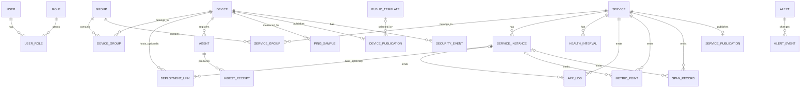

# 資料擁有權與核心 ERD

狀態：REQ-02-T01 設計基準。此文件描述跨需求的核心資料與約束；各模組實際 migration 與資料表依對應需求交付。不可將此圖或測試專用模型當成已驗證的 SQL schema。

## 關係

實線描述業務關聯，不表示已建立物理 SQL FK。Service 與 Device 是獨立資源；沒有部署證據時不建立 `DEPLOYMENT_LINK`。Agent 與 Device 身分不同；ServiceInstance 的來源字串不是 Device 或 Agent 的 ID。群組可同時包含設備及服務；兩類成員各自建立關聯，不以一張多型 FK 表混用身份。

## 全表共用規則

下表的 Resource、Record、Join 與 FrameworkOwned 是 ADR-0001 的表分類。所有 Guid 資源及其他模組引用均使用 `uniqueidentifier`；需要外部協定 ID 的欄位維持原格式。

| 類型 | PK／聚簇／產生方式 | 基本欄位及限制 |
|---|---|---|
| Resource（R） | `Id` nonclustered PK，由應用 `Guid.CreateVersion7()` 產生，EF `ValueGeneratedNever()`；`RowId bigint IDENTITY` unique clustered | `Id != Guid.Empty`；`CreatedAt`、`UpdatedAt` 使用 UTC `datetimeoffset(7)`；可編輯資料使用 `rowversion` |
| Record（D） | `RowId bigint IDENTITY` clustered PK；資料庫產生 | 所屬資源 Guid 與發生時間；來源與接收時間區別保存，查詢索引以 `(資源Id, OccurredAt, RowId)` 起步 |
| Join（J） | 下表指定的複合 PK，clustered；不產生額外 ID | 各成員以 Guid 引用邏輯身分；反向查詢建立必要索引 |
| FrameworkOwned（F） | 採框架指定 key 與生成策略 | 明確屬於 Identity、EF migrations 或 Hangfire 所擁有的子表；不得套用至一般業務表 |

資源名稱、IP、DNS、外部 instance ID 不作平台主鍵；UUID 及 RowId 不作業務時間順序。資料集只提供約束，不以 `Guid` 的 SQL 排序推定建立時間。以下欄位是最低資料字典，非聲稱已定義所有業務表。

## 擁有權與資料字典

每列由所列模組的 DbContext、schema 與 migration 擁有。建議 schema 為 `identity`、`resources`、`network`、`agents`、`services`、`security`、`publishing`、`operations`；同一模組內按責任可進一步拆 DbContext，不能讓另一模組直接修改其表。

| 模組／資料 | 類別 | 最低欄位、參照與唯一性 |
|---|---|---|
| IdentityAccess / User、Role | R | 身分採 Guid Identity 模型；User 正規化登入名稱依 Identity 唯一索引；Role 正規化名稱唯一；角色建立一次後 ID 穩定 |
| IdentityAccess / UserRole、Claim、Login、Token | F | Identity 框架 key／關聯；UserRole 關聯 User、Role 的 Guid；Claims／Logins／Tokens 保留框架契約 |
| Resources / Device | R | 名稱、目標位址、監測模式、生命週期；一個 Device 可被多個群組引用；位址不是全域身份 |
| Resources / Group | R | 名稱及編輯版本；能容納 Device 與 Service，群組不授權、不隱式改公開或收集 |
| Resources / DeviceGroup | J | `(GroupId, DeviceId)`；每對最多一筆；另以 `(DeviceId, GroupId)` 支援反向查詢 |
| Resources / ServiceGroup | J | `(GroupId, ServiceId)`；每對最多一筆；另以 `(ServiceId, GroupId)` 支援反向查詢；ServiceId 屬 ServiceObservability |
| Resources / DeploymentLink | R | 必填 `DeviceId`、`ServiceInstanceId`、可信證據來源與有效期間；filtered unique `(DeviceId, ServiceInstanceId)` 限制每組最多一筆有效關聯，已結束關聯可保留歷史；不以 IP 推定關聯 |
| AgentManagement / Agent | R | `DeviceId` 必填，註冊狀態、能力、最後心跳與版本；同一 Device 同時最多一個有效 Agent（filtered unique index），保留已撤銷歷史；機器憑證只保存必要驗證資訊 |
| AgentManagement / IngestReceipt | D | 可信 `ProducerId`、`BatchId`、payload SHA-256、提交時間；unique `(ProducerId, BatchId)`；來源認證後指派 ProducerId，不信任 payload 自報 |
| NetworkMonitoring / PingSample | D | `DeviceId`、監測位置、OccurredAt／ReceivedAt、結果與延遲；無量測與失敗區分；每筆位置屬於量測，不推論服務健康 |
| ServiceObservability / Service | R | 邏輯名稱、環境、來源授權、收集狀態；不要求 DeviceId 或 IP；核准與公開分開 |
| ServiceObservability / ServiceInstance | R | `ServiceId`、已驗證的 `SourceScopeId` 與外部 `service.instance.id` 原字串；對外部 instance ID 非空且未退役的列，filtered unique `(ServiceId, SourceScopeId, ExternalInstanceId)`；另建 unique `(Id, ServiceId)` 支援同服務的組合 FK。缺少 instance ID 不以名稱或 IP 合併，無法可靠辨識時保留缺失狀態 |
| ServiceObservability / HealthInterval | D | `ServiceId`、狀態、起訖及資料新鮮度；未知、過期與未核准不能記為正常 |
| ServiceObservability / AppLog、MetricPoint、SpanRecord | D | `ServiceId`、可選 instance、事件與接收時間、signal payload；Span 的 TraceId `binary(16)`、SpanId `binary(8)` 保留協定位元組。沒有可靠原始識別時不以內容雜湊刪除重複 OTLP Log |
| Publishing / PublicTemplate | R | 名稱、允許公開欄位、預設標記與版本；至多一個預設由資料庫約束；預設與一般範本遵守相同修改／套用規則 |
| Publishing / DevicePublication、ServicePublication | R | 對應的 DeviceId 或 ServiceId 各自必填且唯一；Public／Private、公開名稱；DevicePublication 的 `PublicTemplateId` 可為空，選 Public 並儲存時才要求有效範本。ServicePublication 獨立呈現服務狀態，不強制套設備範本；匿名永不取得 IP／進階資料 |
| AlertingOperations / Alert | R | 事件來源的明確資源類型與 Guid、狀態、時間及並行版本；不得把 Device 與 Service 身分混同 |
| AlertingOperations / AlertEvent | D | `AlertId`、事件時間、狀態變化；依 AlertId／時間查詢；不以 RowId 作外部事件身分 |
| SecurityAnalysis / SecurityEvent | D | 已驗證來源資源、事件時間、規則／情報版本與證據參照；證據依所屬保留政策保存 |
| 各模組 / MigrationHistory | F | 每個 DbContext 的 migrations history 使用不同表或 schema；由該模組與 EF 管理，不由業務 ID generator 管理 |
| AlertingOperations / Hangfire schema | F | Hangfire SQL storage 自有表與 key；框架升級及清理由部署流程管理，不改造成業務資源表 |

以上 R 表均使用共用 R key／clustered／generator；D 表均使用共用 D key／clustered／generator；J 表採該列複合 PK；F 採各框架契約。跨模組欄位如 `ServiceGroup.ServiceId` 與 `DeploymentLink.ServiceInstanceId` 均為資源 Guid，不引用內部 RowId。

## 參照、交易與刪除

- 同一模組的必要參照由 SQL FK／unique constraint 強制。跨模組採以下 SQL FK，皆引用資源 Guid 主鍵、`NO ACTION`，不得 cascade 修改另一模組；依序先建立目標表，再由來源擁有者的 migration 建約束。跨模組讀寫仍經各模組契約。

| 來源欄位（migration 擁有者） | 目標 | 建立順序 |
|---|---|---|
| Resources.DeviceGroup.DeviceId／GroupId（Resources） | Resources.Device／Group | 目標先，關聯表後 |
| Resources.ServiceGroup.ServiceId（Resources） | Services.Service | Resources 基礎與 Services 先，Resources 後續 migration 建關聯 |
| Resources.DeploymentLink.DeviceId／ServiceInstanceId（Resources） | Resources.Device／Services.ServiceInstance | 兩個目標先，Resources 後續 migration 建關聯 |
| Agents.Agent.DeviceId（AgentManagement） | Resources.Device | Resources 基礎先，AgentManagement 後 |
| Network.PingSample.DeviceId（NetworkMonitoring） | Resources.Device | Resources 基礎先，NetworkMonitoring 後 |
| Publishing.DevicePublication.DeviceId（Publishing） | Resources.Device | Resources 基礎先，Publishing 後 |
| Publishing.ServicePublication.ServiceId（Publishing） | Services.Service | Services 先，Publishing 後 |
| Security.SecurityEvent.DeviceId（SecurityAnalysis） | Resources.Device | Resources 基礎先，SecurityAnalysis 後 |

模組內的 ServiceInstance→Service、訊號→Service／可選 instance、HealthInterval→Service、DevicePublication→可選 PublicTemplate、AlertEvent→Alert、UserRole→User／Role、IngestReceipt.ProducerId→Agent.Id 均由各自模組的 SQL FK 強制；收據參照 Agent 使用 `NO ACTION`。HealthInterval、AppLog、MetricPoint、SpanRecord 的 instance 關聯為可選；若指定 instance，實作須以組合 FK／唯一鍵確保其所屬 Service 一致。Alert 的多型來源（Device 或 Service）以明確類型與 Guid 表示，不虛構無法強制的單一 SQL FK；來源建立與封存由應用契約與 Outbox 處理，顯示歷史時容忍已封存來源。

關聯指向封存資源時禁止新增新的有效成員／部署；以 SQL 交易對目標資源取得必要鎖，與封存狀態更新同步，避免驗證後封存競態。移除連結不刪目標；硬刪被 NO ACTION 約束阻止，只有先執行明確的生命週期與保留程序才能移除參照。
- 模組擁有各自資料；建立跨模組關聯前由來源模組驗證對象，生命週期事件／Outbox 使對方更新或停用關聯。跨交易失敗、重送與重試須可觀察且冪等，不能由直接更新另一模組表代替。
- Agent 自有批次採同一 SQL Server 資料庫、同一 `DbConnection`／`DbTransaction` 的共享交易；協調器僅通過各模組明確寫入契約參與，模組仍擁有自己的表。AgentManagement 在交易中以認證 AgentId 作 ProducerId，寫入唯一 `(ProducerId, BatchId)` 收據與固定 payload SHA-256；各擁有模組寫入完整資料及固定 ItemOrdinal。全部提交成功才 ack；rollback 不留收據或部分資料，重送沿用相同 BatchId、序列化 bytes 與 ordinal。同 key 同 payload 回覆既有成功，同 key 不同 payload 拒絕衝突；並行由 SQL unique constraint 仲裁。這不是標準 OTLP 的一般去重保證；Inbox 保存不得早於可重送窗口及寬限。
- 停用、封存、刪除、重裝及重加的狀態與影響由 REQ-02-T04 定義；不能由 FK cascade 自動決定資料保留、發布狀態或刪除另一個模組資源。原始與彙總資料各自依 REQ-39 設定的保存規則清理，稽核／證據參照不可被一般清理無條件刪除。
- SQL engine 版本、Edition 與相容層級是部署及測試記錄，不由本 ERD 固定。EF SQL Server provider、真實 SQL Server migration、PK／FK／聚簇索引、唯一性與交易的實測證據屬 REQ-02-T02。

## 來源

- [ADR-0001：識別碼與鍵](ADR-0001-identifiers-and-keys.md)
- [ADR-0002：模組與程序邊界](ADR-0002-modular-platform-and-hosts.md)
- [EF Core SQL Server indexes](https://learn.microsoft.com/en-us/ef/core/providers/sql-server/indexes)
